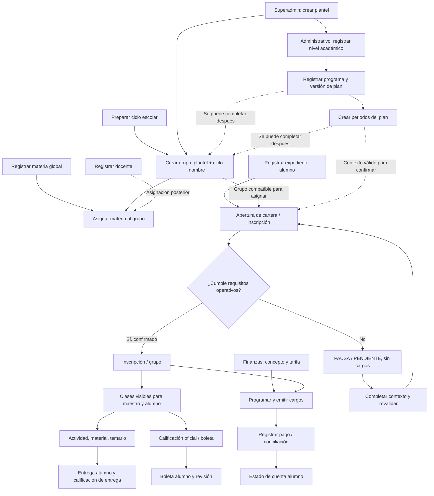
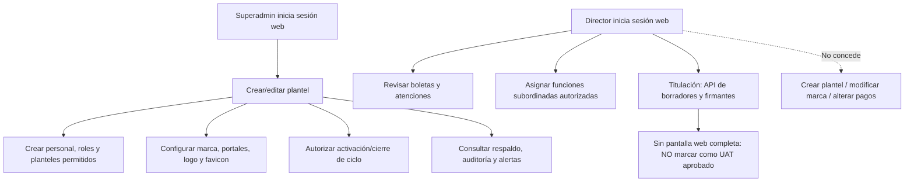
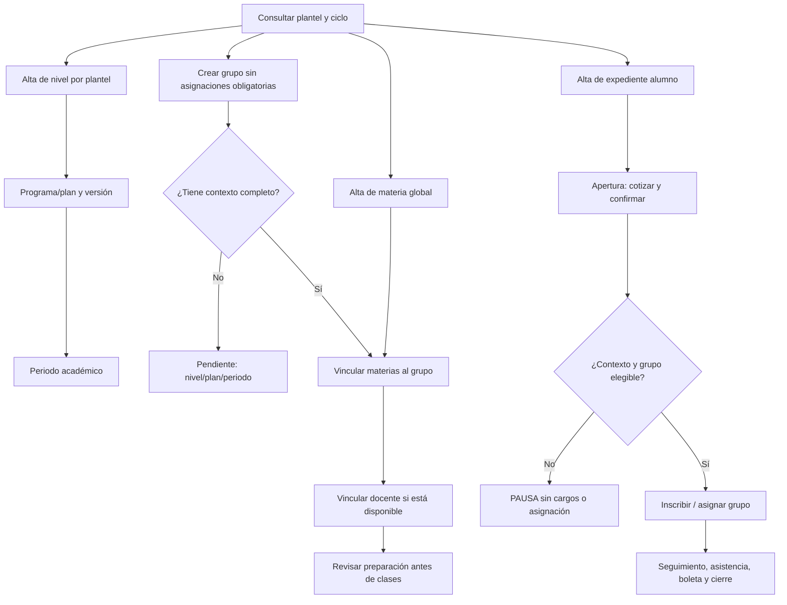
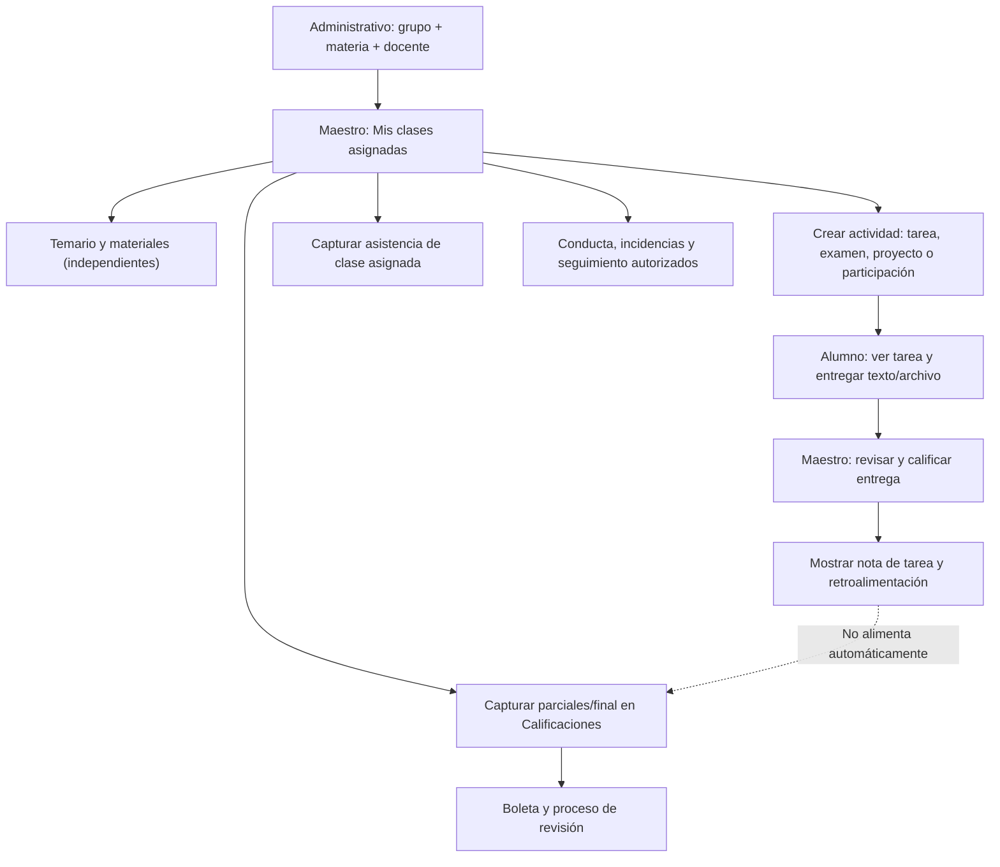
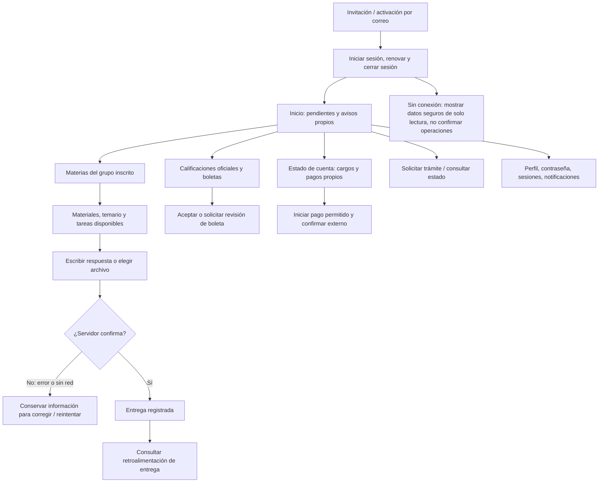
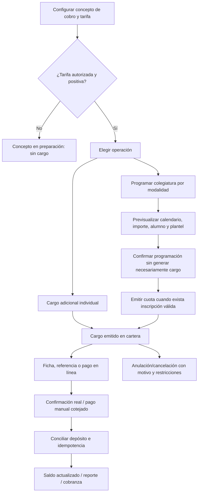
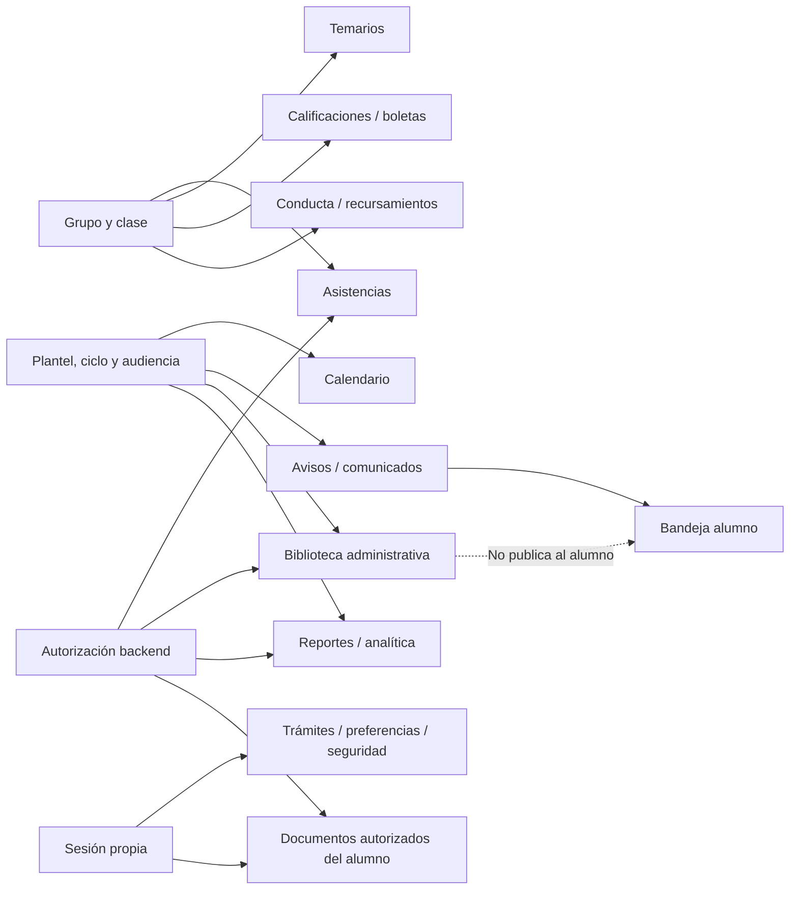

# Mapa integral de procesos del Sistema Escolar IUA

**Corte de repositorio:** main 1.37.0, SHA 90ebeb7701b9227cd706067a2f203a8e6e4f53d5, 13/nov/2026. **Alcance:** API NestJS, web React/Vite, Expo alumno, persistencia, imports, reportes, servicios e infraestructura. El recorrido se reconstruyó mediante código, DTOs, endpoints, rutas, componentes, suites existentes y documentación. **No constituye un ensayo presencial de todos los perfiles ni aceptación UAT**. El usuario confirmó el despliegue staging 1.37.0 (API y tres URLs HTTP 200); las funciones pendientes de PRs no están desplegadas.

## Leyenda y decisiones de diseño

- **CREAR**: guardar una entidad identificable. Puede continuar en preparación si faltan relaciones opcionales.
- **VINCULAR**: ligar una entidad con otra, con validaciones de alcance por plantel, ciclo, programa y clase.
- **OPERAR**: publicar, inscribir, emitir, pagar, aprobar o cerrar. Puede exigir más datos que la creación.
- **PAUSA / PENDIENTE**: registro válido, pero no operativo. Mostrar faltantes y acción para resolverlos.
- **HISTORIAL**: conservar eventos académicos/financieros y versiones; nunca eliminar una relación para simular que no sucedió.
- **Actor**: S=SUPERADMIN, A=ADMINISTRATIVO, F=FINANZAS, M=MAESTRO, D=DIRECTOR, L=ALUMNO. S tiene permisos amplios en API, **pero las funciones que exigen docente asignado o DIRECTOR real mantienen sus reglas específicas**.
- **Web**: A/F/M/D/S. **Expo (app y portal)**: L exclusivamente. La API es la autoridad para roles, relaciones, tarifas y transacciones.

## 1. Mapa maestro de dependencias

**Regla crítica:** crear alumno **no requiere** haber creado un grupo. Para la inscripción ordinaria y emisión de cargos sí deben completarse las condiciones de contexto, asignación y cotización. Crear grupo **no obliga** a tener profesor, materias o alumnos. Crear materia **no exige** plantel ni docente.

## 2. Recorrido por actor: SUPERADMIN y DIRECTOR

**No confundir responsabilidad con permisos.** En main, POST/PATCH /planteles exige SUPERADMIN; el DIRECTOR no crea planteles. La titulación del DIRECTOR ya tiene backend (borradores, firmantes pendientes) pero no tiene ruta web dedicada ni emisión SEP/firma. No simular estas operaciones desde un formulario arbitrario.

## 3. Recorrido académico ADMINISTRATIVO

**Diferencias de versión:** main 1.37.0 exige contexto completo en la apertura ordinaria, aunque permite pausa sin grupo. El PR #245 desarrolló 1.38.0 con plan y periodo pendientes, integrado a una rama de trabajo; PR #247 solicita llevarlo a main. No presentarlo como disponible en staging 1.37.0.

## 4. Recorrido MAESTRO de extremo a extremo

**Secuencia operativa del maestro:** 1) esperar asignación válida de grupo-materia por Control Escolar; 2) abrir clase; 3) crear material/temario o actividad; 4) ver entregas; 5) calificar entrega con comentarios; 6) registrar la evaluación oficial separadamente, justificando correcciones; 7) revisar boletas, asistencias y recursamientos conforme a sus permisos. No crear grupos ni asignarse clases desde la app móvil.

## 5. Recorrido ALUMNO: Expo y portal web alumno

**Condiciones:** el alumno solo ve datos de sí mismo; el portal no administra planteles ni crea docentes. La entrega calificada no se reemplaza, no se confirma sin respuesta API; la nota de tarea no equivale a la nota oficial. Los pagos solo se reflejan al confirmar su aplicación. Un aviso leído no resuelve automáticamente un adeudo o trámite.

## 6. Recorrido FINANZAS: costos, cargos, pagos y conciliación

**Diferenciar:** concepto = catálogo; programación = plan de importes; cargo = deuda emitida; pago = abono confirmado; conciliación = verificación de movimiento. Cargos históricos conservan montos aprobados. Los cargos de colegiatura no se crean desde «cargo adicional». No almacenar tarjetas. La apertura ordinaria es de Control Escolar (ADMINISTRATIVO/S), mientras Finanzas administra tarifas, pagos, cuotas y reinscripción financiera autorizada.

## 7. Recorridos complementarios y relaciones

## 8. Catálogo completo de módulos: operaciones, requisitos y límites

| Módulo / superficie | Quién opera | Requiere primero | Crear / consultar / modificar y salida |
| --- | --- | --- | --- |
| Autenticación, invitación, recuperación | Cuenta autorizada, todos | Usuario/activación según flujo | Activar, recuperar, renovar; sesiones revocables, protección OTP y 30 min inactividad |
| Planteles / personal de plantel | S crea; A/F consulta según alcance | Ninguno para plantel; cuenta para asignar personal | Crear sede sin director; A vincula personal autorizado; S actualiza sede |
| Usuarios y funciones | S, jerarquía A/D limitada | Cuenta personal y plantel según rol | Invitar, activar, editar funciones subordinadas, revocar sesiones; L no es rol de personal |
| Expedientes alumnos / tutor | A/F/S según operación | Plantel, identidad única | Alta de expediente independiente de grupos; editar contacto/estatus, egreso y baja con historial |
| Docentes | A/S; M consulta clases | Cuenta, planteles autorizados para vincular | Alta o vínculo con cuenta existente (1.38.0 pendiente en main); sin clase asignada al crear |
| Catálogos: niveles/planes/periodos | A/S | Plantel; plan requiere nivel; periodo requiere plan y ciclo | Alta y corrección respetando relaciones, versiones e históricos |
| Ciclos escolares | A prepara; S activa/cierra | Fechas/clave | PREPARACION → ACTIVO → EN_CIERRE → CERRADO; no crear cargos por guardar ciclo |
| Materias / materia_contextos | A/S; F consulta contextos autorizados | Clave/nombre para materia; periodo para vínculo | Catálogo global independiente de plantel/docente, reutilizable por múltiples planes |
| Grupos / grupo_materias | A/S | Plantel, ciclo, nombre | Crear vacío; completar contexto compatible, materias y profesores; mostrar pendientes |
| Inscripciones / agrupación | A/S | Alumno, grupo/contexto elegible, reglas de cupo | Altas ordinarias mediante apertura; reactivación reglada; promoción e historial |
| Apertura cartera / reinscripciones | A/S para inicial; F gestiona las opciones financieras permitidas | Alumno, nivel/ciclo; condiciones adicionales según versión | Previsualizar, confirmar, PAUSA, reanudar sin duplicar alumno ni cargos |
| Importaciones CSV/XLSX | A/F/S según tipo | Plantilla, plantel/ciclo y referencias reales | Preview con filas válidas/inválidas/duplicados; confirmación autorizada, sin cargos automáticos por importar inscripción |
| Maestro / clases asignadas | M/S según asignación efectiva | Grupo-materia con docente activo | Consultar clase asignada; no asignarse clases ni ver ajenas |
| Actividades y entregas | M/A crea; L entrega propias | Clase activa/inscripción autorizada | Crear, editar, desactivar; entrega texto/archivo; calificar y retroalimentar sin alterar notas oficiales |
| Temarios y adjuntos | M/A | Clase autorizada | Tema borrador/publicado, orden, fechas, adjuntos privados e historial; no es tarea |
| Calificaciones | M/A según clase/plante | Inscripción y materia; parcial/régimen | Captura, corrección motivada, cierre/reapertura autorizada, Excel; distinguir de notas de tarea |
| Boletas / atenciones | M/A/D consulta; L responde | Calificaciones/inscripción y boleta publicada | Seguimiento, aceptación, revisión, comentarios, versiones y PDF; no recalcular por respuesta |
| Asistencias | M captura asignadas; A consulta; L consulta propias | Clase, inscripción activa | Registro/historial sin aplicar sanción ni nota automática |
| Conducta | M/A | Alumno inscrito y plantel/grupo dentro del alcance | Registrar incidencia y seguimiento; sin automatizar sanciones |
| Recursamientos | M/A, L consulta propios | Historial de materia reprobada, ciclo | Plan y evaluación de recursamiento autorizados; no cobrar automáticamente |
| Programas especiales | A/S | Plantel, ciclo, oferta, fechas | Grupo especial y participantes; no confundir grupo regular |
| Calendario | A/M/F según alcance; L consulta | Ciclo, nivel/plantel y audiencia según evento | Evento, imagen, edición y baja con trazabilidad; no genera clase o tarea |
| Avisos, comunicados, correo | A/S; L consulta | Plantel, audiencia, plantilla y consentimiento según canal | Borrador, preview, publicación idempotente; correo/push real sujeto a configuración |
| Trámites y seguimiento | L solicita; A/S gestiona | Identidad; tipo de solicitud | Estado, responsable e historial; resolver no emite un documento oficial o cargo |
| Calidad de datos | A/S | Expedientes/alcance | Diagnóstico y preview/corrección autorizada; no fusiona ni inventa grupos |
| Finanzas: conceptos | F/S | Clave, tipo permitido y monto base | Alta con monto 0 preparatorio; corrección, activo/inactivo; no crear deuda por alta |
| Finanzas: programaciones/colegiaturas | F/S | Concepto, alumno, periodo/ciclo, tarifa y reglas | Programar, previsualizar, emitir cuotas con inscripción; evita duplicados |
| Finanzas: cargos adicionales | F/S | Alumno, concepto permitido, monto positivo | Crear cargo con idempotencia, cancelar con motivo; no usar para colegiatura |
| Finanzas: pagos y fichas | F/S; L propio | Cargo válido y medio de pago | Ficha, intento, depósito comprobado, pago parcial/completo, anulación auditada |
| Finanzas: conciliación y cobranza | F/S | Movimiento bancario o cargo, plantel | Preview CSV, aplicar a cargo, gestionar incidencias; no duplicar pagos |
| Estado de cuenta | L propio; F/A autorizado | Cargos/pagos históricos | Ver saldos propios, descarga PDF, pago seguro; no es catálogo |
| Biblioteca privada | A/S | Plantel/carpeta; antivirus real | Subir/consultar/retirar archivos privados; no difunde a alumnos ni maestros |
| Archivos firmados y documentos | Según recurso | Dueño/inscripción/plantel y autorización API | Descarga temporal; material, boleta y archivos privados, sin URL genérica pública |
| Reportes y analítica | A/F/M/S según tipo; L boleta propia | Plantel/ciclo o clase según reporte | XLSX, PDF, gráficas por alcance; distinguir ingresos de utilidad |
| Titulación/firmantes | D con plantel autorizado en API | Alumno egresado, historial y plan válido; firmante autorizado | **Solo borradores y firmantes pendientes**; sin ruta web principal ni emisión SEP |
| Configuración / marca y portal alumno | S | Cuenta y recursos permitidos | Logo, favicon, colores, mensaje y configuración; no modificar datos académicos |
| Seguridad, sesiones, respaldo | Titular de cuenta; S supervisa | Sesión/host autorizados | Cierre/revocación, backup operativo y alertas; restore aislado pendiente de UAT |
| Eliminación permanente | S, altamente restringido | Ausencia de vínculos y auditoría | Solo supuestos de baja permanente válidos; no usar como operación ordinaria |
| ETL legado y migraciones | Operador técnico | BD aislada, manifiesto, backup | Prueba previa, importación conciliada, nunca contra staging sin plan aprobado |
| App Expo / portal alumno | L | Identidad activa y datos propios | Inicio, materias, tareas, notas, pagos, perfil, calendario, documentos, trámites y push opt-in |

## 9. Tareas guiadas con datos reales y estados

### ¿Cómo crear un alumno?
1. **Antes**: SUPERADMIN crea plantel; Control Escolar prepara nivel y ciclo; el programa/periodo puede prepararse después según versión.
2. **Crear expediente**: Alumnos → Registrar. Validar nombre(s), apellidos, matrícula, identidad, contacto y plantel. No se requiere grupo para el registro.
3. **Operar inscripción**: Apertura de cartera → buscar expediente o registrar alumno nuevo → seleccionar contexto autorizado → previsualizar. Si falta contexto, conservar estado pendiente/pausa solo si el flujo de la versión desplegada lo admite.
4. **Confirmar**: revisar cuotas/cargos y grupo elegido, o asignación automática. La API decide elegibilidad y evita duplicados.
5. **Después**: activar acceso del alumno, revisar clases visibles y estado de cuenta; no mezclar alta de expediente con cobro recibido.

### ¿Cómo crear una materia?
1. ADMINISTRATIVO → Materias → Registrar → clave y nombre.
2. Guardar **sin** plantel/profesor/grupo.
3. Vincular a planes y periodos aprobados solo cuando existan.
4. En Grupos → Administrar → añadir materia a grupo compatible.
5. Asignar docente cuando esté disponible. Antes de impartir, verificar docente, inscripción y ciclo.

### ¿Cómo crear un grupo?
1. ADMINISTRATIVO → Grupos → Registrar → plantel, ciclo, nombre.
2. Opcional: nivel, programa/plan y periodo **completos y compatibles si se proporcionan**.
3. Guardar aunque no haya materias/docentes/alumnos.
4. Grupos → Administrar → asignar materias; después docentes.
5. Inscribir mediante flujo autorizado, no desde importación sin previsualización de cartera.

### ¿Cómo trabajar como docente?
1. Control Escolar asigna grupo-materia-docente y verifica plantel.
2. Maestro → Mis clases → abrir clase → temario/materiales.
3. Crear actividad con título, descripción opcional, tipo, parcial, peso informativo y vencimiento opcional.
4. Alumno entrega texto o archivo, con confirmación servidor.
5. Docente abre entregas → califica y comenta; posteriormente captura nota oficial en Calificaciones si corresponde.

### ¿Cómo realizar una tarea como alumno?
1. Acceder a Expo/portal alumno, abrir Materias → Mis tareas.
2. Revisar actividad, parcial y fecha; elegir Archivo o Texto.
3. Confirmar envío; si falla la red, no se considera entregada.
4. Comprobar estatus y nota de entrega; si ya está calificada, no sustituir.
5. Consultar la boleta oficial separadamente.

### ¿Cómo crear un concepto, colegiatura y registrar pago?
1. FINANZAS → Catálogo de conceptos: seleccionar tipo válido y tarifa autorizada. Monto 0 es preparatorio.
2. Elegir si corresponde **cargo adicional** o **programación de colegiatura**, que siguen flujos distintos.
3. Programar con modalidad/ciclo/plantel, previsualizar cuotas e inscripción elegible. Confirmar solo la operación autorizada.
4. Emitir cargo; comprobar que no se duplicó el mismo periodo.
5. Cotejar ficha/depósito, registrar pago idempotente y conciliar.
6. Verificar saldo de alumno e historial. Para corregir usar anulación/cancelación con motivo; no editar importes históricos silenciosamente.

## 10. Reorganización recomendada, no ejecutada sin UAT

- **Unificar experiencia, no reglas:** mismo patrón de pantallas «Consultar / Registrar / Administrar / Historial» en catálogos, alumnos, grupos, usuarios y finanzas; reutilizar buscadores, paginación y ayuda.
- **Separar funciones distintas:** materias vs asignaciones; tarea/retroalimentación vs notas oficiales; expediente vs inscripción; concepto vs programación vs cargo vs pago; calendario vs actividad; biblioteca privada vs materiales de clase; aviso vs envío.
- **No retirar sin análisis de referencias:** módulos de egreso, recursamientos, titulación, historial, auditoría o reportes aunque sean poco usados; revisar consumidores de API y datos existentes antes de desactivar.
- **Añadir acceso web dirigido (pendiente):** titulación/director requiere flujo de consulta de egresos autorizado y catálogo compatible, pantalla protegida y UAT. La API actual no ofrece un selector directo de egresos por Director.
- **Mejorar navegación:** ayudas contextuales por ruta, estado sin datos, botón siguiente paso y pendientes derivados; jamás hacer «guardar» que crea automáticamente cargos, clases o usuarios.
- **Conservar permisos:** no hacer director superadmin, no conceder finanzas al maestro ni administración al alumno.

## 11. Hallazgos transversales

| ID | Severidad | Ubicación / evidencia | Impacto | Corrección priorizada |
| --- | --- | --- | --- | --- |
| J-01 | Alta | backend/src/titulacion/titulacion.controller.ts y web/src/App.tsx | Backend titulación sin journey web para DIRECTOR | PR nuevo de descubrimiento/selección de egresos, ruta protegida y aceptación SEP, sin emitir títulos |
| J-02 | Alta | backend/src/cartera/cartera.dto.ts, PR #245/#247 | Apertura 1.37.0 exige plan/periodo, frena alta parcial | Integrar 1.38.0 con pruebas reales y UAT; nunca emitir cargos en pausa |
| J-03 | Alta | backend/src/finanzas/conceptos.service.ts | El tipo de concepto puede modificarse aunque existan cargos históricos | Impedir transiciones inseguras o versionar catálogos tras revisar datos históricos en BD |
| J-04 | Media | web/src/pages/Maestro.tsx | Journey docente no separa claramente calificar entrega y nota oficial | PR de ayudas docentes y prueba de interfaz |
| J-05 | Media | mobile/src/screens/Tareas.tsx | Guía de tareas y vacío no explican totalmente confirmación/estado | PR de ayudas alumno y regresión |
| J-06 | Media | web/src/layout/Shell.tsx | Ayudas genéricas faltantes para boletas, recursamientos, apertura, ciclos y otros | PR de guías por ruta sin cambiar guard |
| J-07 | Media | docs/MATRIZ_ACCESO.md frente a web/src/App.tsx | Director necesita recorrido distinto de S; gestión institucional no uniforme | Mostrar permisos reales y limitaciones en guías y mapa |
| J-08 | Media | web/src/pages/Finanzas.tsx y componentes | Multitud de vistas de cobro y nomenclatura similares | Agrupar menú por «Preparar tarifa / Emitir / Cobrar / Conciliar», sin fusionar registros ni alterar APIs |
| J-09 | Media | backend/src/actividades/actividades.service.ts y web/src/pages/Calificaciones.tsx | Nota de tarea separada de calificación oficial | Explicación explícita, no suma automática sin reglamento |
| J-10 | Media | backend/src/notificaciones/notificaciones.controller.ts | Guardar borrador no equivale a publicar ni entregar correo | Mostrar preview, estado, destinatarios y canales verificados |
| J-11 | Media | Configuración/archivos/ETL, docs/ESTADO_IMPLEMENTACION.md | Antivirus, iOS físico, restore y proveedores externos no acreditados | UAT aislada con responsable y evidencia |
| J-12 | Media | backend/src/academico/grupos.service.ts y backend/src/catalogos-academicos/contexto-grupo.ts | Grupo admite alta vacía, pero contexto parcial no es válido cuando se envía | Mostrar campo opcional como unidad completa y pendiente corregible |

## 12. PRs y estado de ejecución

- **PR #246** — UI de materia, grupo, conceptos y finanzas; estados vacíos y guías; no cambia API.
- **PR #247** — integración de apertura parcial 1.38.0 a main, desde PR #245; requiere CI y UAT.
- **PR docencia/alumno** — ayuda en clase, tareas y distinción de notas.
- **PR ayudas por ruta** — orientación en web con permisos reales.
- **PR de este mapa** — auditoría, diagramas y plan UAT; sin cambios operativos.
- **PRs futuros separados:** titulación web/egresos, inmutabilidad de conceptos históricos, rediseño de navegación financiera y pruebas end-to-end.

**Validación por ejecutar** para cada SHA nuevo: lint, tipos, build, unitarias, integración MySQL/SQL Server, Playwright 360/768/1280/1920, roles cruzados, fallos de red, lectura con teclado/lector, UAT operativa y pruebas móviles físicas. Ninguna ruta de GitHub ni test simulado acredita ejecución en staging.

Consulta además [Plan UAT integral](PLAN_UAT_INTEGRAL_2026-11-13.md), [arquitectura](../ARQUITECTURA.md), [matriz de accesos](../MATRIZ_ACCESO.md) y [API](../API.md).
